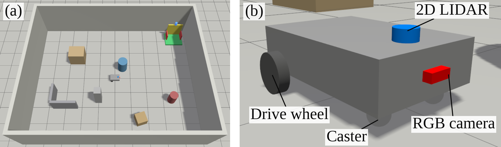
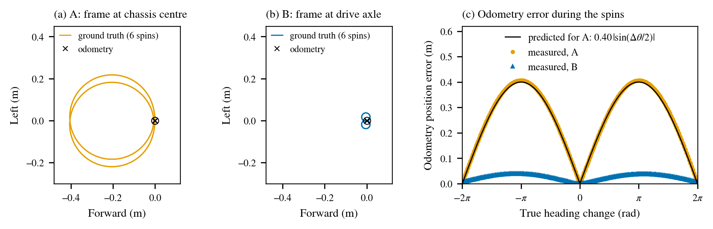

# Industrial AMR: Frontier Exploration and Nav2 Navigation in ROS 2

A simulated differential-drive industrial autonomous mobile robot (AMR) with a 2D LIDAR and
an RGB camera. It explores an unknown 10 × 8 m factory room by itself with a custom
frontier explorer, saves the map, and then navigates it with Nav2. The stack runs on
ROS 2 Jazzy and Gazebo Harmonic, and it was evaluated against the simulator's ground truth.



## Results

All results are from simulation, measured against Gazebo's ground-truth pose.

**Autonomous mapping** (10 runs):
- exploration took 95 s on average (65–113 s);
- the robot mapped 79.5 m², or 97.4 % of the 80 m² room;
- occupied map cells lie 3.3 cm from the true surfaces on average;
- 9 of 10 runs returned to the start. In run 4 the robot got stuck against a crate.

**Map-based navigation** (3 sessions, 45 waypoint goals):
- Nav2 reported all 45 goals reached;
- 27 of the 45 final poses were within the 0.20 m and 0.15 rad goal tolerance against
  ground truth, because Nav2 judges success on the AMCL estimate;
- the mean final position error was 11 cm, and the AMCL position RMSE was 9.8 cm.

The data, failure notes and the scripts that produced these numbers are in
[`paper/data`](paper/data/README.md) and [`paper/experiments`](paper/experiments). The full
write-up is the course paper [`paper/Project_of_Mechatronics.pdf`](paper/Project_of_Mechatronics.pdf).

## Rotation-center study

The robot turns about its drive-axle midpoint, 0.20 m behind the chassis center, but
`base_link`, the Nav2 footprint and the controller's motion model all treat the chassis
center as the turning point. A pre-registered controlled experiment compared the original
frame with one moved onto the axle (branch `rotation-center-study`), over 6 spins,
15 mapping runs and 150 navigation goals per condition:

- the predicted odometry error of 0.40·|sin(Δθ/2)| m was confirmed (0.406 m peak during a
  spin) and removed by the fix;
- AMCL position RMSE fell from 0.100 to 0.061 m, and the median final position error from
  0.117 to 0.103 m;
- the share of goals within tolerance did not improve (71 % vs 66 %), because the yaw
  tolerance decides it;
- with the inflation radius and waypoints left unchanged, the robot body came closer to
  obstacles.



Protocol: [`research/rotation_center/README.md`](research/rotation_center/README.md).
Results: [`research/rotation_center/REPORT.md`](research/rotation_center/REPORT.md).

## How it works

- **Mapping mode:** slam_toolbox builds the map while the frontier explorer sends goals to
  Nav2. Frontier detection is pure NumPy and unit-tested. Goals are chosen by cluster size
  and distance, at least a minimum distance from the robot, which handles the start-up map
  whose only frontier surrounds the robot. Exploration ends after three consecutive checks
  find no frontier, and the robot returns to its start.
- **Navigation mode:** map_server and AMCL localize the robot on the saved map. A waypoint
  runner drives a five-waypoint mission, and a global localizer recovers the pose when the
  robot is lost.
- **Shared motion pipeline:** both modes use one Nav2 configuration. Application nodes only
  send Nav2 actions and never publish velocity commands, so the collision monitor is always
  the last stage before the robot:

  ```
  MPPI controller ─► velocity smoother ─► collision monitor ─► Gazebo DiffDrive
  ```

- **Charger keepout zone:** the charger's 0.10 m base plate lies below the LIDAR's scan
  plane and never appears in the SLAM map. A Nav2 keepout filter marks it in both costmaps.

## Repository layout

```
src/
├── industrial_amr_description/   URDF/xacro robot model
├── industrial_amr_gazebo/        world, ROS–Gazebo bridge, simulation launch
├── industrial_amr_navigation/    Nav2 and slam_toolbox configs, saved map, keepout mask
├── industrial_amr_exploration/   frontier explorer, waypoint runner, global localizer, tests
└── industrial_amr_bringup/       top-level mapping and navigation launch files, RViz configs
paper/
├── Project_of_Mechatronics.pdf   course paper
├── experiments/                  headless run orchestration, ground-truth logger, metrics
├── data/                         recorded runs and computed metrics
└── output/                       paper figures and the scripts that generate them
research/rotation_center/         rotation-center study: protocol, data, analysis, report
```

## Requirements

- Ubuntu 24.04
- ROS 2 Jazzy, Gazebo Harmonic (`ros_gz`), Nav2, slam_toolbox

Clone the repository and install the remaining dependencies with rosdep:

```bash
git clone https://github.com/AchrefTebini/industrial-amr-nav2.git
cd industrial-amr-nav2
rosdep install --from-paths src --ignore-src -y
```

## Build and test

```bash
source /opt/ros/jazzy/setup.bash
colcon build --symlink-install
source install/setup.bash
colcon test && colcon test-result --verbose
```

## Usage

### 1. Map the room

```bash
ros2 launch industrial_amr_bringup mapping.launch.py
```

Arguments: `headless:=true` runs Gazebo without its GUI, `rviz:=false` skips RViz, and
`explore:=false` disables the explorer so you can drive by hand with
`ros2 run teleop_twist_keyboard teleop_twist_keyboard`.

When the robot is back at the start, save the map:

```bash
ros2 run nav2_map_server map_saver_cli -f src/industrial_amr_navigation/maps/industrial_room \
  --ros-args -p save_map_timeout:=10.0
```

### 2. Navigate on the saved map

```bash
ros2 launch industrial_amr_bringup navigation.launch.py   # map:=/path/to/map.yaml
```

AMCL starts at the spawn pose. Send goals with the "Nav2 Goal" tool in RViz, or run the
waypoint mission:

```bash
ros2 run industrial_amr_exploration waypoint_runner \
  --ros-args --params-file src/industrial_amr_exploration/config/waypoints.yaml
```

If the robot is lost, recover its pose with:

```bash
ros2 run industrial_amr_exploration global_localizer --ros-args -p use_sim_time:=true
```

## Known limitations

- On `master`, `base_link` is at the chassis center rather than the axle midpoint (see the
  rotation-center study above).
- The keepout mask is in the map frame and assumes the robot spawns at the origin.
- The stack is not fully namespace-clean: the camera bridge, the RViz configs and the keepout
  filter use absolute topic names.
- The docking server is configured but has no dock detector yet.

## Troubleshooting

- **Nav2 hangs at `Configuring <node>`** with `failed to send response to
  /<node>/change_state (timeout)`: a DDS service reply was lost. Stop the launch, run
  `ros2 daemon stop && fastdds shm clean && ros2 daemon start`, and launch again.
- **Nav2 does not start after an earlier session:** look for orphaned processes with
  `ps -eo pid,etime,cmd | grep -E 'nav2|lifecycle'` and stop them by PID.
- **The controller stalls before a goal:** keep goals at least 0.8 m from obstacles
  (0.55 m inflation radius plus the footprint).

## Note on commit references

The study protocol (`research/rotation_center/README.md`) and the `provenance.json` run
records cite commits of the private development repository: `0bebd95` is the code on
`master` and `3e760cb` the `rotation-center-study` branch. This repository starts from a
snapshot of that code; `master` differs from `0bebd95` only in comments, and
`rotation-center-study` produces the same robot model and Nav2 parameters as `3e760cb`.

## License

The code is released under the Apache License 2.0 (see [`LICENSE`](LICENSE)).
The paper (`paper/Project_of_Mechatronics.pdf`) is © its authors and is not covered by this license.
